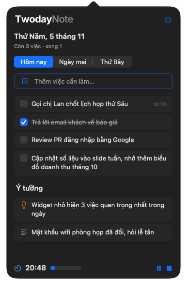

<p align="center">
  <picture>
    <source media="(prefers-color-scheme: dark)" srcset="Brand/TwodayNote-lockup-dark.svg">
    
  </picture>
</p>

<p align="center">
  A tiny macOS menu bar app for jotting down tasks, notes, and ideas for today and tomorrow, plus a list of things to look at later, with a Pomodoro focus timer.
</p>

<p align="center">
  
</p>

## Features

- **Lives in the menu bar.** No Dock icon, no window to manage. Click the icon or press **⌃⌥N** from any app.
- **Today and tomorrow.** Two tabs, switch with **⌘1 ⌘2**.
- **Overdue at a glance.** Unfinished tasks from earlier days move to the top of today with an orange mark: "từ T4" (since Wednesday) or "trễ 3 ngày" (3 days late).
- **Xem sau (look at later).** A third tab, **⌘3**, for things you came across and want to see later: links, snippets, screenshots. No day, no deadline, never carried over to today.
- **Link cards.** Paste a GitHub or YouTube link into Xem sau and it files itself under a "GitHub" or "YouTube" heading. Repos show their description, stars, language, and topics; videos show their thumbnail, title, and channel. Click to open.
- **Four kinds of blocks.** Type a prefix at the start of a line:

  | Prefix | Block |
  | --- | --- |
  | *(none)* or `[] ` | Task with a checkbox |
  | `- ` | Note |
  | `* ` | Idea |
  | `# ` | Heading |

- **Edit in place.** Click any text to change it, drag to reorder, right-click to change its kind, move it to another day, or delete it. Deletes can be undone.
- **Paste images.** Press **⌘V** with an image on the clipboard: it goes into the block you're editing, or waits under the add field until you press Return. Click a thumbnail to see it large inside the popover; pinch, **⌃ + scroll**, double-click, or **⌘= ⌘-** to zoom, and drag to move around. Finishing a task deletes its images (with Undo).
- **Nothing falls through.** Unfinished tasks from earlier days move to the top of today, marked with the day they came from.
- **Count in the icon.** The menu bar icon shows how many tasks are left today, and goes blank when you're done.
- **Focus timer.** A 15, 25, 45, or 60 minute countdown at the bottom of the popover. The time left runs next to the menu bar icon, and a sound plays when it's over.
- **Settings.** Language, launch at login, global shortcut, menu bar count, carry-over, light or dark mode, Liquid Glass on or off (off gives the classic look from before macOS 26), and accent color.

The interface is in Vietnamese or English (Settings > Chung > Ngôn ngữ).

## Download

TwodayNote needs **macOS 26 or later** and runs on both Apple silicon and Intel Macs.

1. Download `TwodayNote-<version>.dmg` from the [latest release](https://github.com/blakenguyen97/twoday-note/releases/latest).
2. Open the DMG and drag **TwodayNote** into **Applications**.
3. Open TwodayNote from Applications. It has no Dock icon: look for the card icon in the menu bar.

### "TwodayNote can't be opened" on first launch

The app is not notarized by Apple yet, so macOS blocks the first launch. To allow it once:

1. Open **System Settings › Privacy & Security**.
2. Scroll down to the message about TwodayNote and click **Open Anyway**, then confirm.

Or run this once in Terminal:

```sh
xattr -dr com.apple.quarantine /Applications/TwodayNote.app
```

## Build from source

Requires Swift 6.2 or later. The Command Line Tools are enough; Xcode is not needed.

```sh
git clone https://github.com/blakenguyen97/twoday-note.git TwodayNote
cd TwodayNote
./build.sh --open
```

`build.sh` builds a release binary, wraps it in an app bundle, signs it, installs it to `~/Applications/TwodayNote.app`, and opens it. It signs with your Apple Development certificate if you have one, and ad hoc otherwise.

To start TwodayNote when you log in, turn on **Mở cùng macOS** in Settings (••• › Cài đặt…).

## Your data

Everything stays on your Mac, in one JSON file and a folder of pasted images:

```
~/Library/Application Support/TwodayNote/notes.json
~/Library/Application Support/TwodayNote/Images/
```

There is no account, sync, or network access.

## Development

| Task | Command |
| --- | --- |
| Build and install | `./build.sh` (add `--open` to restart the app) |
| Unit tests | `tools/test.sh` |
| Self-test on the real app (temporary data) | `tools/selftest.sh` |
| Screenshots in light and dark mode | `tools/snap.sh` → `/tmp/TwodayNote-shots/` |
| Spacing check | `tools/grid-lint.sh` |
| Release DMG (universal, ad hoc signed) | `tools/release.sh` → `dist/TwodayNote-<version>.dmg` |

`tools/snap.sh` opens the popover and takes keyboard focus for a few seconds while it runs.

The app is a Swift package with no Xcode project. [CLAUDE.md](CLAUDE.md) has the build rules and notes on building with only the Command Line Tools.
